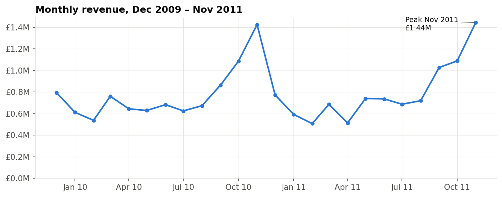
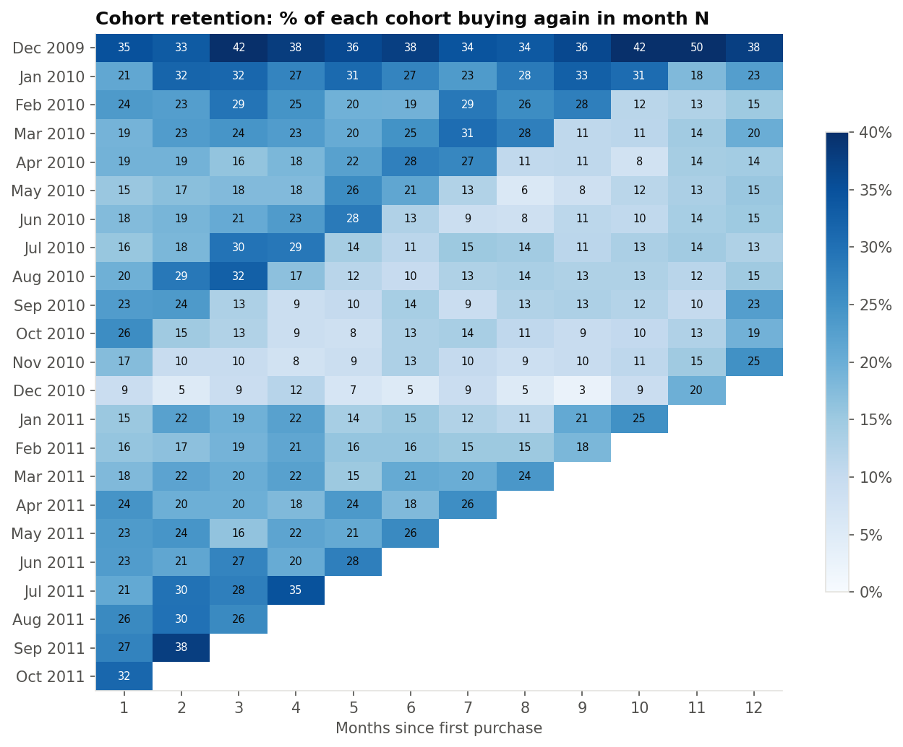
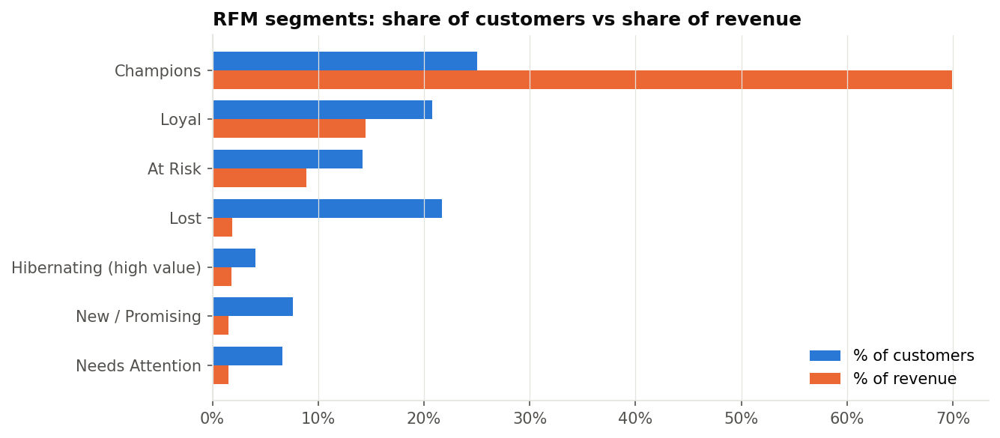

# Online Retail: Cohort Retention & RFM Segmentation

End-to-end customer analytics on **1,067,371 real transaction lines** from a UK online gift retailer (Dec 2009 – Dec 2011). The work covers data profiling, cleaning, KPI tracking, cohort retention, RFM segmentation and revenue concentration. All analysis is written in **SQL (DuckDB)**, orchestrated with **Python**, and published as an **interactive dashboard**.

**Live dashboard:** https://nabeel1199.github.io/ecommerce-cohort-rfm/



## Business questions

1. How clean is the raw data, and what has to be fixed before it can be trusted?
2. How does revenue move over time? Is there seasonality?
3. Do new customers come back? How fast do cohorts drop off?
4. Which customers matter most, and which valuable customers are drifting away?
5. How concentrated is revenue across customers, countries and products?

## Key findings

| | Finding |
|---|---|
| Data quality | 3.2% of rows were exact duplicates. 22.8% had no customer ID. 1,382 lines were same-day order-and-cancel entry mistakes worth £420K, e.g. 80,995 paper crafts ordered and cancelled 12 minutes later. |
| Scale (after cleaning) | £19.29M revenue · 39,397 orders · 5,850 identified customers · 4,873 products |
| Seasonality | Revenue nearly **triples** from the quietest month (Feb 2011: £0.51M) to the peak (Nov 2011: £1.44M). Nov 2011 is only +1.4% on Nov 2010. |
| Retention | Only **~21%** of a cohort buys again in month 1, and **~18%** in month 12. Still, **72%** of customers order more than once over two years. Autumn 2010 cohorts spike again at month 12: Christmas buyers come back for the next Christmas. |
| Segments (RFM) | **Champions** are 25% of customers but **69.9% of revenue**. **At Risk** customers (frequent buyers who went quiet) are 830 customers with £1.49M of past revenue. |
| Concentration | The top 20% of customers generate **76.8%** of revenue. The UK is 85.3% of revenue. The #2 market, Ireland (3.2%), is only **3 customers**. |
| Returns | After removing entry mistakes, cancellations are 2.0% of gross sales. Some products are outliers, e.g. Pantry Chopping Board with 82% of units cancelled. |
| Timing | Orders peak around 12:00. There are only 30 Saturday orders in two years, so Saturdays are effectively closed. |





## Recommendations

- **Win-back campaign for "At Risk" customers.** This is the largest pool of lost value (£1.49M historically) and they already know the catalogue.
- **Protect the Champions.** A quarter of customers bring in 70% of revenue, so it is worth account management and early access to stock before Q4.
- **Plan stock, staffing and cash flow for Sept–Nov**, when demand nearly triples.
- **Review high-return products** before reordering them.
- **Capture a customer ID on every order.** About 13% of revenue cannot be tied to a customer today.

## Cleaning rules

Rules are in [`sql/02_clean.sql`](sql/02_clean.sql), and each is measured first in [`sql/01_data_quality.sql`](sql/01_data_quality.sql).

1. Remove exact duplicate rows (34,335).
2. Keep real products only: stock codes starting with 5 digits. This drops postage, Amazon fees, bank charges and manual adjustments.
3. A sale is a non-cancelled line with quantity > 0 and price > 0. Cancellations (`C…` invoices) go into their own table.
4. **Same-day full reversals are removed from both sides.** These are lines cancelled in full on the same day for the same customer, product, price and quantity. Without this rule, a single mistyped order makes a random product look like a best-seller and a 100%-returned item.
5. Lines without a customer ID stay in revenue totals but are excluded from customer-level analysis (cohorts, RFM, Pareto).
6. December 2011 is a partial month (data ends 9 Dec), so it is excluded from monthly trends and cohorts.

## Project structure

```
├── scripts/download_data.py      # downloads the UCI dataset -> data/raw/*.parquet
├── sql/
│   ├── 01_data_quality.sql       # profiling the raw data
│   ├── 02_clean.sql              # dedup, sales, cancellations, entry-error reversals
│   ├── 03_monthly_kpis.sql       # revenue, orders, AOV, MoM / YoY (LAG window functions)
│   ├── 04_cohort_retention.sql   # monthly cohorts, retention matrix, repeat rate
│   ├── 05_rfm_segmentation.sql   # NTILE scoring -> 7 customer segments
│   └── 06_customers_products_countries.sql  # Pareto, countries, products, returns, timing
├── src/
│   ├── pipeline.py               # runs the SQL in order, exports results to exports/*.csv
│   ├── charts.py                 # static charts for this README
│   └── build_dashboard.py        # builds docs/index.html (GitHub Pages)
├── notebooks/analysis.ipynb      # executed walkthrough of every step
├── exports/                      # result tables (also used for Tableau)
└── TABLEAU_GUIDE.md              # how to rebuild the dashboard in Tableau Public
```

## How to run

```bash
python3 -m venv .venv && source .venv/bin/activate
pip install -r requirements.txt
python scripts/download_data.py     # ~45 MB download, converted to Parquet
python src/pipeline.py              # runs all SQL, writes exports/*.csv
python src/charts.py                # README figures
python src/build_dashboard.py       # docs/index.html
python scripts/make_notebook.py     # re-executes the notebook
```

The full pipeline runs in about 2 seconds on a laptop: DuckDB queries the Parquet file directly, with no database server.

## SQL techniques used

CTEs · window functions (`LAG`, `NTILE`, running `SUM … ROWS BETWEEN`, `ROW_NUMBER`) · self-joins (matching cancellations to their original sale) · `FILTER` aggregates · conditional segmentation with `CASE` · date arithmetic (`date_trunc`, `datediff`) · regex validation.

## Limitations

- One retailer, and mostly wholesale buyers, so order values are much higher than typical consumer e-commerce.
- No cost data: this is a revenue analysis, not a profit analysis.
- RFM uses quintiles. Many customers have exactly one order, so frequency scores at the low end are split by customer ID (documented in the SQL).
- The Dec 2009 cohort includes customers who bought before the dataset starts, so it is excluded from the average retention figures.

## Data & licence

Dataset: Chen, D. (2012). *Online Retail II* [Dataset]. UCI Machine Learning Repository. https://doi.org/10.24432/C5CG6D, licensed under [CC BY 4.0](https://creativecommons.org/licenses/by/4.0/). The raw data is not committed; `scripts/download_data.py` fetches it.

Code: MIT licence. See [LICENSE](LICENSE).
